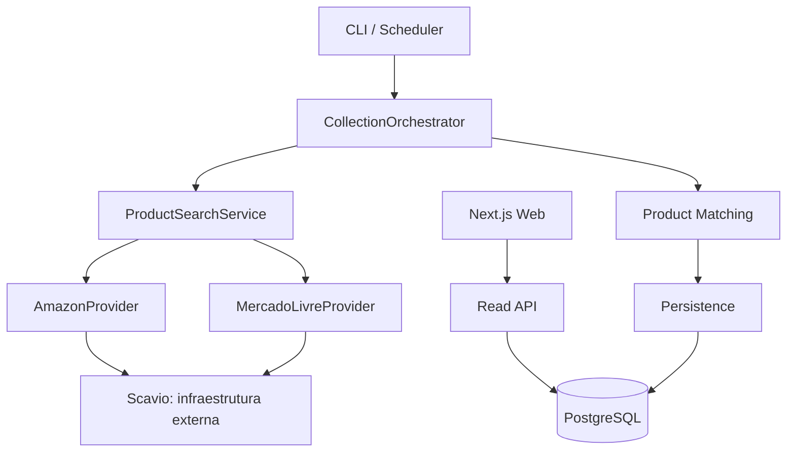

# Price Tracker

Price Tracker é uma aplicação de portfólio para acompanhar preços de produtos no
Brasil. Em vez de mostrar apenas o menor valor atual, ela mantém histórico e
contexto para responder: **o preço atual está baixo, normal ou alto?**

> O repositório não publica um badge de CI porque a URL do repositório GitHub não
> está fixada aqui. Ao publicar o projeto, adicione o badge do workflow `CI`.

## Problema e solução

Marketplaces expõem preços em formatos diferentes e mudam com frequência. O
projeto adapta Amazon e Mercado Livre para um contrato comum, valida respostas,
normaliza produtos e ofertas, relaciona produtos equivalentes com cautela e grava
observações imutáveis de preço. A interface consulta somente o catálogo já
persistido: buscar não aciona provedores externos.

## Funcionalidades

- Busca paginada no catálogo persistido, com ordenação global por cobertura de
  histórico ou menor preço atual.
- Página de produto com preço atual, mínimo, máximo, média e classificação.
- Histórico bruto ou agregado e ofertas ativas atuais.
- Coleta manual e agendamento single-process opcional.
- Matching determinístico e auditável entre providers.
- Histórico append-only e retries idempotentes por `collectionKey`.
- CI com PostgreSQL real, testes mockados de providers e builds da API/web.

## Arquitetura



## Stack

- Node.js 22 LTS, TypeScript e Zod
- Next.js, React, Tailwind CSS e Recharts
- PostgreSQL e Prisma
- Docker Compose, GitHub Actions e Vitest

Versões verificadas na revisão de dependências: Node.js 22, Next.js 16.4.6,
React 19.3.1, Prisma 7.10.1, PostgreSQL 16, Zod 4.6.7 e Recharts 2.15.4.

## Como rodar localmente

Pré-requisitos: Node.js 22 (veja [`.nvmrc`](.nvmrc)) e Docker Desktop.

```bash
npm install
Copy-Item .env.example .env
Copy-Item apps/web/.env.example apps/web/.env.local
npm run db:up
npm run db:generate
npm run db:migrate
```

Em dois terminais:

```bash
# API em http://localhost:3001
npm run dev:api

# Web em http://localhost:3000
npm run dev --workspace=@price-tracker/web
```

Para uma coleta manual — que exige `SCAVIO_API_KEY` válida no `.env` privado:

```bash
npm run collect -- "iphone 15"
```

O PostgreSQL de desenvolvimento expõe `localhost:5433`. Dentro dos containers do
Compose de produção, a API usa `postgres:5432`; nunca use `localhost` como host
do banco entre containers.

## Variáveis de ambiente

| Área | Variável | Finalidade |
| --- | --- | --- |
| Backend privada | `DATABASE_URL` | Conexão PostgreSQL. |
| Backend privada | `DIRECT_DATABASE_URL` | URL direta do Neon, exclusiva para migrations e restauração. |
| Backend privada | `SCAVIO_API_KEY` | Necessária somente para coleta externa/scheduler. |
| Backend privada | `SCAVIO_AMAZON_TIMEOUT_MS` | Timeout da Amazon via Scavio. |
| Backend privada | `API_PORT` | Porta da Read API. |
| Backend privada | `CORS_ORIGIN` | Origem única liberada ao frontend. |
| Backend privada | `COLLECTION_SCHEDULER_ENABLED` | Liga/desliga o scheduler single-process. |
| Backend privada | `COLLECTION_INTERVAL_MINUTES`, `COLLECTION_TIMEOUT_MS`, `COLLECTION_STALE_RUN_MINUTES` | Limites da coleta. |
| Frontend pública | `NEXT_PUBLIC_API_BASE_URL` | URL pública da API; é embutida no build web. |

Não use `NEXT_PUBLIC_*` para banco, tokens ou chaves de providers. A API valida
`DATABASE_URL`, porta e CORS no bootstrap; a coleta valida sua chave e timeouts
antes de montar clients externos. Mensagens de configuração são sanitizadas.

### Neon em produção

Use a URL **pooled** do Neon com `sslmode=require` em `DATABASE_URL`, para o
runtime. Defina `DIRECT_DATABASE_URL` com a URL **direta, não pooled**, também
com `sslmode=require`, para `prisma migrate deploy`, `pg_dump` e `pg_restore`.
O Prisma CLI prioriza `DIRECT_DATABASE_URL`; o desenvolvimento local continua
usando somente `DATABASE_URL` em `localhost:5433`.

## Docker

O [docker-compose.yml](docker-compose.yml) contém somente o PostgreSQL de
desenvolvimento. Para ensaiar o conjunto de produção localmente:

```bash
docker compose -f docker-compose.prod.yml up --build
```

Se já houver API/web local nas portas 3001/3000, escolha portas alternativas e
passe a mesma URL pública ao build web, por exemplo no PowerShell:

```powershell
$env:API_HOST_PORT = "3101"
$env:WEB_HOST_PORT = "3100"
$env:NEXT_PUBLIC_API_BASE_URL = "http://localhost:3101"
docker compose -f docker-compose.prod.yml up --build
```

O compose de produção executa `prisma migrate deploy` em um serviço único antes
da API. Ele não lê `.env` para injetar a chave Scavio. Se o scheduler for ligado,
copie `.env.production.example` para `.env.production` e preencha a chave apenas
no host de deploy. Esse arquivo é ignorado pelo Git e pelas imagens.

As imagens também podem ser construídas separadamente:

```bash
docker build -f apps/api/Dockerfile -t price-tracker-api .
docker build --build-arg NEXT_PUBLIC_API_BASE_URL=https://api.example.com -f apps/web/Dockerfile -t price-tracker-web .
```

## Testes e CI

```bash
npm run test:api
npm run test:web
npm run build:api
npm run build:web
```

O workflow [CI](.github/workflows/ci.yml) executa em `push` e `pull_request`.
Ele usa PostgreSQL 16 como service container, aplica migrations, roda testes de
API e web e gera ambos os builds. Providers externos são exercitados somente com
mocks/fixtures: a CI não exige nem chama Scavio.

## Revisão de dependências

O audit de produção é executado com `npm audit --omit=dev`. Após a migração
controlada para Prisma 7.10.1, o resultado é `0 critical`, `0 high` e
`0 moderate`. Recharts 2.15.4 continua usado pelo gráfico; sua atualização para
a linha 3 é melhoria funcional futura, não correção de segurança atual.

### Avaliação do Prisma 7

O Prisma 7 usa ESM, o generator `prisma-client` e client gerado em
`apps/api/src/generated/prisma` (não versionado). O `prisma.config.ts` da raiz
carrega `DATABASE_URL` explicitamente e aponta para o schema e as quatro
migrations existentes. Execute `npm run db:generate` após uma instalação limpa.

Em runtime, `createPrismaClient(databaseUrl)` cria um único `pg.Pool`, o adapter
`@prisma/adapter-pg` e o PrismaClient. A factory é a única dona do lifecycle:
desconecta o client e encerra o pool. API, CLI e testes recebem o client pronto;
repositories não criam conexões. A versão de `pg` é unificada no monorepo para
que o pool e o adapter compartilhem o mesmo construtor.

No desenvolvimento local, `NEXT_PUBLIC_API_BASE_URL` precisa ser acessada
diretamente como `process.env.NEXT_PUBLIC_API_BASE_URL` para ser incorporada pelo
Next.js. A função de configuração aceita override apenas para testes; o caminho
normal usa o acesso estático e aponta a web `3000` para a API `3001`.

## Produção

A API é compilada para `apps/api/dist` e pode iniciar sem `vite-node`:

```bash
npm run build:api
npm run start:api
```

Antes de iniciar uma nova versão, gere o client e aplique migrations com
`npm run db:generate` e `npm run db:migrate` (`prisma migrate deploy`). A API
expõe `GET /health`, que responde com estado da aplicação, banco e timestamp.
Encerramentos `SIGINT`/`SIGTERM` param o scheduler, fecham o HTTP server,
desconectam o Prisma e encerram o pool PostgreSQL.

O scheduler é intencionalmente single-process. Em produção, habilite-o em **uma
única** réplica com `COLLECTION_SCHEDULER_ENABLED=true`; mantenha-o desligado nas
réplicas de leitura.

## Estrutura

```text
apps/
  api/       Read API, coleta, matching, persistência e Prisma
  web/       Frontend Next.js
docs/        Contexto, arquitetura e decisões
.github/     Automação de CI
```

## Screenshots

O MVP prioriza a pergunta “o preço atual está baixo, normal ou alto?” antes dos
detalhes técnicos. A interface usa tokens próprios de cor, tipografia e
espaçamento, oferece busca no catálogo persistido, resumo histórico, gráfico e
ofertas ativas. Para demonstrar localmente, inicie API e web, pesquise por
`iphone 15` e abra um resultado. A captura deve usar somente dados públicos do
catálogo local — nunca arquivos `.env`, chaves ou URLs privadas.

## Limitações e roadmap

- O scheduler não possui lock distribuído; use uma instância para coleta.
- A busca lê apenas o catálogo existente; não coleta sob demanda.
- Não há autenticação, favoritos, alertas ou notificações neste MVP.
- O próximo passo de infraestrutura é escolher hospedagem e configurar secrets
  no provedor, sem expor `.env.production`.

## Opções de deploy futuras

Para portfólio, Vercel é uma boa opção para o frontend, enquanto Render, Railway
ou Fly.io acomodam a API Node. Neon, Supabase, Railway ou Render podem hospedar
PostgreSQL. Planos gratuitos tendem a suspender serviços ociosos e não garantem
execução contínua do scheduler; para coleta confiável, mantenha uma instância da
API sempre ativa ou migre o scheduler para job/worker dedicado no futuro.
